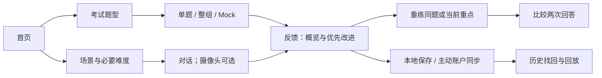

# SpeakNow 全站核心功能与交互优化 · 2026-10-24

本报告承接 `docs/product-2026-10-23/REPORT.md` 的代码审计与首轮改动。所有模拟题均为自编材料。**控制流程已验证，不等于真实 AI 质量、真人视觉测量或生产环境已验收。**

## 1. Existing Features：审计与复用

| 现有系统 | 审计结果 / 本轮处理 | 验证范围 |
|---|---|---|
| React/Vite、现有 React Router、Node API | 直接复用；修复路由等待退出动画导致反馈页不挂载的问题 | 类型检查、构建、浏览器时钟跳变压力流程 |
| VoiceCapture / VoiceInteraction | 直接复用唯一录音与对话状态；没有新建第二套语音系统 | 原有 10 组控制器检查、React 控件检查、浏览器多轮录音 |
| AudioTake、MediaRecorder、Web Audio RMS | 扩展同一录音器记录开始时间与时长 | 浏览器真实假设备 MediaRecorder；回放及时间上限 |
| Three.js Voice Orb | 保留；麦克风振幅消费真实 RMS，AI 播放状态消费真实播放事件 | 原有生命周期测试、桌面/移动截图；真人设备 GPU 未验证 |
| 现有 MediaPipe Face/Pose Worker | 原来只在 Expression Lab 使用；提取共享帧调度，接到 Daily 的可选预览 | 真实模型/WASM 初始化、测试视频亮度、缺失人脸处理；初始化失败有明确降级 |
| CameraPreview | 保留组件；增加权限超时、延迟授权清理、pagehide/track-ended/卸载释放 | 权限拒绝、延迟授权、关闭后语音继续可用 |
| IndexedDB learningStore、账户鉴权、voiceSessions、私有媒体桶 | 直接复用；扩展已有记录、删除动作和历史比较 | 本地 API/数据库端到端；跨账户隔离和媒体清理 |
| Supabase REST / Storage 适配器 | 真实适配器存在；修复远端删除请求，使用 bucket + prefixes | HTTP 合约测试；未连接真实生产桶验证 |
| LLM 接口 | 复用现有服务与试用限流；只接受引用原句的结构化反馈 | 受控模型响应、503 恢复、无转写 422；真实提供商未验证 |

实际存储使用已有 `app_voice_sessions.report.learning` JSONB，音频使用已有私有 `speaknow-recordings` 适配器。没有新数据库、UI 框架、状态库或新增依赖。已有快照和旧字段记录的幂等保存单独测试；没有迁移或重写生产用户数据。

## 2. Changes Made：实际代码

- `shared/speakingTasks.js`：原有题目结构增加步骤级计时、自编 TOEFL Mock、IELTS Part 2 追问、Quick/Set/Mock 记录、时间位置；复述对齐增加可能替换/词序变化。保留原有 LCS 字段与旧题目 ID。
- `src/pages/ExamSpeaking.jsx`、`ExamPractice.jsx`：复用原考试控制器，单题入口、整组入口和 Mock；Mock 自动播放、录音、限时停止、保存和切题。Part 2 首题 60/120 秒，后续简短追问无准备、30 秒练习上限。
- `src/lib/expressionVisionSession.js`：**必要新增**，把原 Expression Lab 帧调度抽成共用生命周期，避免 Daily 再实现同一套 Worker 管理。每次最多一帧在处理中，初始化与处理超时可恢复。
- `src/lib/expressionLandmarks.js`：**必要新增**，从原 Worker 提取纯几何计算，继续由原 Worker 调用，支持真实缺失/遮挡单元测试。
- `shared/visualEvidence.js`：**必要新增**，前后端共用特征白名单与大小限制，避免分别维护两套校验。只保存最多 90 个时间窗口的派生特征，不接受像素、心理标签或原始视频。
- `scripts/build-expression-worker.mjs` / `.gitignore`：构建时复制已安装 MediaPipe 的 WASM 到站点静态目录，生成物不提交；不新增依赖。
- `expressionVision.worker.js`、`expressionInsights.js`：复用 Face/Pose；增加可见口部开合、眼部位置/尺度及低分辨率整帧亮度；共享原有窗口汇总逻辑。
- `CameraPreview.jsx`、`VoiceChat.jsx`、`CasualVideo.jsx`：Daily 明确主动开关；视频独立于麦克风；Expression Lab 也使用共享帧调度。摄像头特征与答案使用同一练习时间基准。
- `AudioTake.js`、`learningStore.js`、`LearningReview.jsx`：在现有记录中保存时长、特征和快照；反馈折叠详情、时间位置、转写词数/填充词及每录音分钟词数；单题重练保持单题。
- `api/speaking-practice.js`、`api/_mediaStore.js`：已有 API 增加归属校验后的删除；先清理媒体再清理记录；存在关联重练时拒绝删除原记录。客户端删除也清理当前设备缓存。其他设备的离线副本不自动消失。
- `api/speaking-feedback.js`：没有转写的纯录音 Mock 返回明确 422；记录保留可回放。摄像头特征不作为文字模型证据，避免文字模型假装分析音视频。
- `App.jsx`、`index.css`、`VoiceSetup.jsx`、`VoiceReport.jsx`、`voice-room.css`：路由不等待退出动画，保留原生短淡入；兼容旧设置链接，折叠旧反馈与辅助说明。
- `tests/learning/*`：扩展原测试；新增真实模型初始化检查。隔离测试服务的模型响应明确带 Engineering fixture 标识，普通开发预览不使用它。

## 3. UI Simplification：逐页处理

| 页面/阶段 | 唯一主要任务 | 结果 |
|---|---|---|
| `/` | 选择 Academic / Daily | 保留两个主入口；演讲、Expression Lab 等在次要折叠入口 |
| `/exam` | 选题型 | 默认 Quick Practice；整组为次要链接，Mock 在考试模块内按需展开 |
| `/exam/practice` | 完成当前回答 | 当前步骤一个主要操作；有转写后重录降为次要按钮；Mock 隐藏编辑、重录和手工切题 |
| `/voice` | 选场景并开始 | 场景 + 必要难度 + 开始，场景预览按需展开 |
| `/voice/setup` | 兼容旧链接 | 依赖检查确认没有内部入口后，去掉旧重复配置界面；保留路由并直接转到已有练习；旧考试配置转到真正考试入口 |
| `/voice/chat` | 当前对话 | Orb、唯一主状态、核心录音控制；最新两条消息；历史、设置、场景按需打开；摄像头小预览无实时评分面板 |
| `/practice/review` | 看重点并重练 | 默认概览和最多三项重点，第一项展开；答案、音频、语音/摄像头证据、考试标准、删除操作均按需展开 |
| `/practice/history` | 找回记录 | 继续草稿、原回答、反馈、重练；不把完整历史放进练习页 |
| `/voice/report`、`/voice/history` | 找回旧内容 | 保留；旧反馈细节默认折叠，会话与统计合并在展开区域 |
| `/voice/casual-video` | 专项视频重练 | 保留；标题/承诺条精简，方法说明合并折叠，录制时隐藏笔记侧栏 |
| Presentation 的上传/分析/练习/反馈/报告/历史 | 演讲专项各阶段 | 保留已有阶段与 Impact 闭环；作为次要模块，不复制到两条主线 |
| `/profile`、`/auth`、`/admin`、404 | 账户/管理/恢复 | 保留既有权限与组件；不加到练习首屏 |

实际主路径：

## 4. Academic Training：状态

| 功能 | 状态 | 证据与限制 |
|---|---|---|
| TOEFL Listen and Repeat | 已实现并测试通过 | 7 题整组/单题、听后录音、隐藏原文、回放、对齐与重练；识别错误可能影响文本对齐 |
| TOEFL Take an Interview | 已实现并测试通过 | 4 个相关问题、45 秒、无准备、反馈与保存 |
| TOEFL Speaking Mock | 已实现并测试通过 | 7 + 4 顺序，8/10/12 秒模拟分配及 45 秒采访，自动录音和切题；题量/时限依据官方，逐句具体时长为本套模拟配置。浏览器 TTS 和文字界面替代官方录制材料/采访视频，不宣称是 ETS 考试仿真或官方分数 |
| IELTS Part 1 | 已实现并测试通过 | 连续熟悉话题；60 秒是练习上限，不是官方逐题时限 |
| IELTS Part 2 | 已实现并测试通过 | 60 秒准备、最长 120 秒、Cue Card、简短追问；追问 30 秒为练习上限。Quick 只做主问题，整组包含追问 |
| IELTS Part 3 | 已实现并测试通过 | 与 Part 2 相关的抽象讨论；90 秒是练习上限 |
| 四项 IELTS 标准 / 新 TOEFL 1–6 | 部分完成 | 标准/版本已区分，文字反馈引用真实转写；发音、声学流畅度及官方估分不评。没有套用旧 0–30 换算 |
| 题库扩展 | 已实现基础结构；导入后台尚未实现 | 来源、版本、题型、材料、计时、音频字段、练习快照和重练关联；没有冒充官方真题 |

核对依据：[ETS Speaking](https://www.ets.org/toefl/test-takers/ibt/about/content/speaking.html)、[ETS Updated Overview](https://www.ets.org/content/dam/ets-org/pdfs/toefl/toefl-ibt-test-overview.pdf)、[ETS Scores](https://www.ets.org/toefl/test-takers/ibt/scores/understand-scores.html)、[IELTS Speaking](https://www.ielts.org/take-a-test/test-types/ielts-academic-test/ielts-academic-format-speaking)。Storage 删除合约依据 [Supabase 官方实现](https://github.com/supabase/storage-js/blob/master/src/packages/StorageFileApi.ts)。

## 5. Daily & Camera Analysis：状态

- **已实现并测试通过**：现有多轮状态、真实录音容器、失败重试不重复消息、结束/保存/重练/比较；保留 Orb；主动摄像头、关闭/卸载/pagehide 清理；摄像头拒绝后语音仍可用。
- **已实现并测试通过（限定测试画面）**：真实 MediaPipe/WASM 加载，测试视频亮度汇总；无脸测试画面不生成头/眼/姿态指标；没有原始视频上传。见 `vision-results.json`。
- **已实现但尚未真人验证**：头部/眼部几何变化、可见肩部/手腕变化、口部开合变化、眼部位置/尺度等端侧特征。它们是相对几何量，不是完整头部角度、绝对视线/眼神接触、手势含义、情绪或自信判断。
- **部分完成**：多模态报告统一收纳语言、录音时长、转写指标和视觉时间窗，但没有临床/心理推断，也没有可靠发音或语调测量。视觉记录最多保存前 12 分钟的汇总窗口；关闭/缺失/被遮挡的指标显示 Not assessed。
- **尚未实现**：声学发音/语调/清晰度评分、可靠静音停顿与轮次质量评分、画面清晰度评分。原始视频保存/上传入口没有新增，因此不会未经单独授权保存视频。
- **限制**：浏览器 SpeechSynthesis 无可访问的 PCM 振幅。AI 播放时 Orb 显示真实播放状态，未声称输出振幅与声音逐样本同步；麦克风振幅来自真实 RMS。

## 6. Learning Loop：验证

- `npm test`：**62/62**；保留原 47 项，学习模块共 15 项。包含字段升级时旧快照不变、所属账户、不可变回答、私有媒体、重练关联、删除保护、模型失败和空转写拒绝。
- `npm run lint`、`npm run typecheck`、`npm run build`：通过。构建仅有已有 Browserslist 数据陈旧提示。
- `check-voice-interaction.mjs`、`check-voice-recording.mjs`、`check-orb-lifecycle.mjs`、`check-exam-standards.mjs`：通过。
- **16 组浏览器验收通过，pageErrors 为空**：五种题型、Part 2 准备和追问、单题重练保持单题、Mock 全 11 题、日常两轮/刷新/反馈/重练/比较、登录返回、清除 IndexedDB 后从账户 API 找回、两次音频回放、AI 故障恢复、麦克风拒绝、限时停止、草稿继续、摄像头拒绝/关闭/延迟授权、删除和移动布局。
- 模型、ASR、TTS 的语义输出使用明确受控测试；MediaRecorder 记录 Chromium 的实际测试设备流；数据库、鉴权、HTTP、存储和回放走真实本地代码。测试不证明真人发音识别准确率或真实 AI 质量。
- 真实模型/WASM 视频分析另跑 `tests/learning/vision-browser.mjs`，结果与上述模型响应 fixture 分开。

## 7. Remaining Issues：不能宣布已验收的部分

1. **真实 LLM 对话与反馈质量尚未验证**：普通本地环境未配置可用的服务端模型 Key；正常预览返回真实、可恢复错误。不能以 fixture 代表线上 AI。
2. **真实 Supabase、部署环境尚未验证**：本轮验证本地持久化和 Storage HTTP 合约；未迁移、删除或读取生产用户内容。
3. **真人麦克风、摄像头、移动设备/GPU 尚未验证**：需要实机验证识别、回声、遮挡、光线、浏览器原生语音及长时性能。重复初始化曾出现超时，已移除 WASM CDN 依赖；Face/Pose 模型文件仍需网络下载，失败会降级而不阻止语音。
4. **声学及完整视觉评分尚未实现**：详见第 5 节，所有不具证据的维度不评分。特征端侧报告不等于经过标定的质量结论。
5. **Mock 材料有限**：自编题 + 浏览器 TTS；没有 ETS 官方音视频，没有完整 IELTS 真人考官 Mock，也没有题库导入后台。当前不具备宣称与真实考试完全等价的条件。
6. **历史改善趋势有限**：可比较原句/反馈/音频与记录具体重练，但不声称已测得学习增益，不伪造分数曲线。

普通预览与测试服务隔离。本轮测试不配置、替换或绕过生产密钥。
